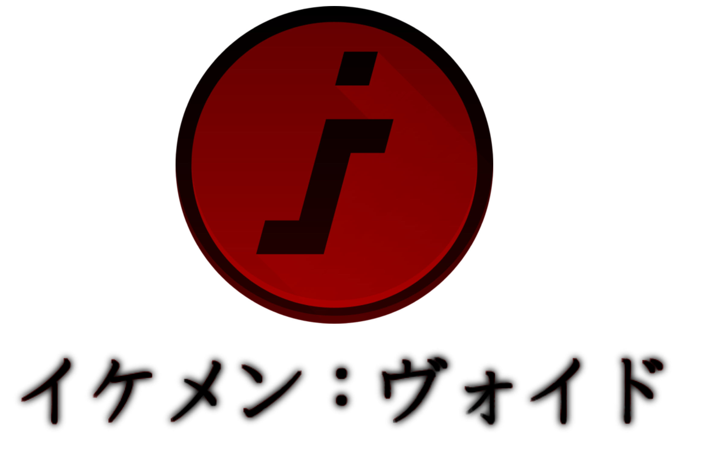

<p align="center">
  <a href="https://ikemen-void.neocities.org/">
    
  </a>
</p>

# IKEMEN:VOID

**IKEMEN:VOID** is a custom engine fork designed to bridge the gap between legacy MUGEN content and modern engine capabilities. It acts as a true universal MUGEN/IKEMEN engine capable of running WinMUGEN, 1.0, 1.1, legacy screenpacks, and extreme cheapies without modification.

[Official Website](https://ikemen-void.neocities.org/) • [Version History & Build Notes](https://ikemen-void.neocities.org/versions) • [Discord Server](https://discord.gg/wJymsvW2kA)

---

## Features & Build Status (v3.0.2 RC1)

IKEMEN:VOID focuses on stability, massive scaling, and deep compatibility:

- **Crash-Free Core:** Solidified core execution stability under heavy loads.
- **Monster API Tier Detection:** Automated cheapie character and tier identification.
- **Active KO Bridges:** Confirmed operational support for `void_SuperNullKO` and `void_LeetKO`.
- **Massive Roster Support:** Full compatibility with WinMUGEN screenpacks featuring **8,000+ slots**.
- **AI Hygiene Pass:** Fully cleaned script files with zero Unicode tells.

---

## Installing & Testing

Ready-to-test development builds are coordinated through our official community channels. **Beta testing and bug reporting applications are permanently open with no deadlines.**

### 📺 Video Walkthroughs & Setup Guides

- [Watch Setup & Configuration Guide #1](https://www.youtube.com/watch?v=0L7HDZ0gH7Y)
- [Watch Engine Features & Walkthrough #2](https://www.youtube.com/watch?v=kNTd0H-vIhQ)

### 1. Installing a Screenpack

A screenpack controls menus, titles, select screens, versus screens, and lifebars. VOID reads it from `save/void_motif.cfg`.

- Copy the whole screenpack folder into `screenpacks/YourPackName/` (requires a `system.def`).
- Open `save/void_motif.cfg` in Notepad and set the motif line:

```ini
motif = screenpacks/YourPackName/data/system.def
```

- To use stock menus instead: `motif = stock`
- Category headers in `select.def` use **Page Up / Page Down** or **LT / RT** (`q` / `w`) to change pages.

### 2. Adding Characters & Stages

- **Characters:** Drop each character folder into `chars/CharacterName/` containing its `.def`, `.sff`, `.air`, `.cns`, etc. List them in your active `select.def` under `[Characters]`.
- **Stages:** Put stage files in `stages/` and list them under `[ExtraStages]` in `select.def`.
- **Roster Cleaner:** Run `python force_clean_select.py` from the root folder to automatically scan your active `select.def` against `chars/` and remove missing entries (creates a `.bak` backup first).

### 3. VOID Converter

The VOID Converter lays out an existing WinMUGEN, MUGEN 1.0, 1.1, or IKEMEN game for VOID:

```bash
python void-converter.py SOURCE DEST
python void-converter.py SOURCE DEST --quick
```

- `--quick` skips deep character scans and focuses on priority rewrites.
- Check `DEST/conversion_report.html` after conversion.

### 4. Performance Settings for Low-End PCs

Open `save/config.ssz` in Notepad to adjust older hardware flags:

```ssz
const bool PreloadPortraits = false;
const bool CompileOnSelect = true;
const int MaxCachedChars = 10;
const bool ReduceEffects = true;
const bool BackgroundLoading = false;
const bool LightBackgroundLoading = true;
```

### 5. Force Show Mode (Show Everyone)

To auto-list unlisted characters from your `chars/` folder and skip empty gap slots, open `save/void_motif.cfg` and set:

```ini
force_show = 1
grid_max_columns = 12
grid_max_rows = 8
scroll_speed = 1
```

### 6. Legacy IKEMEN GO Modules (Advanced)

To try legacy GO modules (like SelectPlus), open `save/void_motif.cfg` and set `legacy_module_support = 1`, then copy modules into the root folder.

---

## 🔍 The Tier System & Monster API

The Monster API (`script/void_monster_api.lua`) scans character CNS/state files at character select and classifies them:

| Tier                  | Description                          | Behavior                     |
|-----------------------|--------------------------------------|------------------------------|
| `winmugen`            | Normal character                     | Runs as-is                   |
| `supernull` / `stbof` | Parser overflow / ROP chain          | Bridge fires native KO       |
| `hypernull`           | ZLib code execution                  | Bridge fires native KO       |
| `ultranull`           | DLL injection                        | Bridge fires native KO       |
| `leet`                | DtC `%nF#` format-string kill        | Bridge fires native KO       |
| `voidshell`           | Calls `VoidShell.Dll` safely         | Runs without loading the DLL |
| `antimalware`         | Registry/kernel driver writes        | Runs with a VM warning       |

---

## 📁 Key Files & Log Reference

| File                             | Purpose                                           |
|----------------------------------|---------------------------------------------------|
| `script/void_monster_api.lua`    | Tier classifier and signature scanner             |
| `script/void_monster_bridge.lua` | Per-frame fight hook; fires native KOs            |
| `save/monster_api.log`           | Runtime log of detections and bridge firings      |
| `save/failed_chars.log`          | Characters that failed to load                    |
| `save/match_guard.log`           | Match Guardian notes from fights                  |
| `save/void_perf.log`             | Loaded performance flags                          |
| `save/void_roster.cache`         | Cached roster data (delete to force full rebuild) |

---

## 🛠️ What We Use & Anti-AI Policy

- **The Core:** Powered by the C/C++ upstream architecture of **IKEMEN Plus Ultra** (by CableDorado2 and contributors).
- **The VOID Layer (`script/`):** All custom features — including the Monster API, Monster Bridge, Universal Matrix Grid, Roster Cacher, and Python utility scripts (`force_clean_select.py`, `void-converter.py`) — were written entirely in-house using plain text editors and command-line tools.
- **AI Policy:** No AI text generators, code assistants, or automated tools were used in the creation, structuring, or coding of this fork.

---

## 👥 Credits & Development Team

- **Mikazuki The Mugenite** — Lead Developer / Creator (MUGEN author, cheapie enthusiast, co-owner of Mugen Database Cheapie Guide)
- **Anonymous** — Developer (Engine and systems work)
- **scristopher** — Collaborator / Ikemen Model & Sprite Artist (Custom models, sprites, and animations)

Upstream engine authors include Suehiro, Alceris, K4thos, ShinLucho, NeatUnsou, Windblade, Dan, Kidcy, Wintermourn, Shiyo Kakuge, Kamekaze, two4teezee, TheFclass97, Rodknee, Ros, Yamori X, Jade Midori, PlasmoidThunder, Strong FS, CD2, and other IKEMEN contributors.

---

## License

IKEMEN:VOID is released under the **IKEMEN PLUS ULTRA License** — free for personal, educational, and non-commercial use. Bundled community assets remain the property of their respective authors.
```
